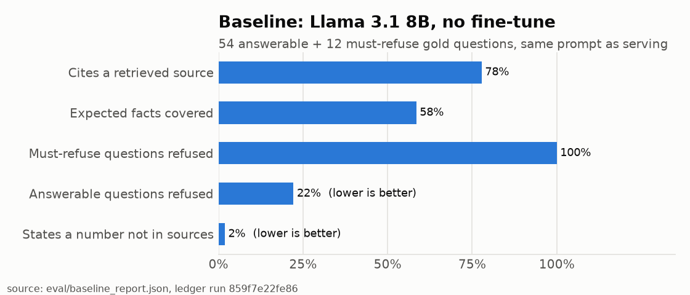
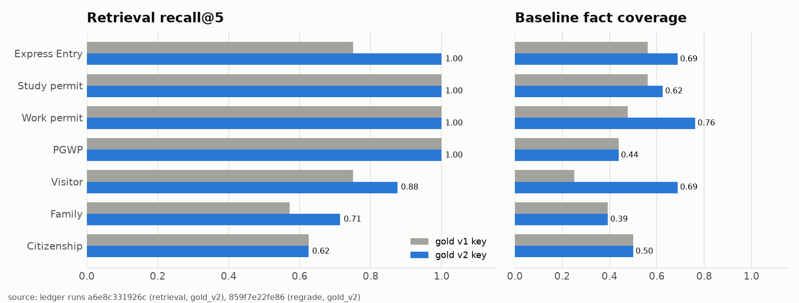

# Visa Buddy v2: progress log

Generated by `python -m pipeline.report` from `runs/ledger.jsonl` and `eval/`. Every number below links to the ledger run that produced it.

## Gates

| Gate | Status | Evidence |
|---|---|---|
| gold_v1 frozen before indexing | done | 66 questions (12 must-refuse), sha256 `cb290965f9fe…`, run `c1b04c584eef` |
| gold_v2 answer key (same questions) | done | +40 reviewed source pages, sha256 `40442b22a0b9…`, run `790993006110` |
| Corpus split by page URL | done | {'gold_heldout': 64, 'train_eligible': 431}, run `58415288127a` |
| recall@5 ≥ 0.7 before training | pass | 0.815, run `933a39ed6a15` |
| Baseline (no adapter) scored | done | meta-llama/Llama-3.1-8B-Instruct, 4bit-nf4, complete=True, run `dae69d130eea` |
| Teacher quality gate | pass | 2 runs; latest `ddc30615f894` (see Teacher gate) |
| SFT data card checks | pass | 311 train / 41 valid, refusal share 0.283, run `f704cf5612b7` |
| QLoRA training | not started | |

## Retrieval (gold_v1)

| Program | n | R@1 | R@3 | R@5 | R@10 | MRR@10 | fact coverage@5 |
|---|---|---|---|---|---|---|---|
| Express Entry | 8 | 0.50 | 0.50 | 0.75 | 0.88 | 0.58 | 0.88 |
| Study permit | 8 | 0.88 | 1.00 | 1.00 | 1.00 | 0.94 | 1.00 |
| Work permit | 7 | 1.00 | 1.00 | 1.00 | 1.00 | 1.00 | 1.00 |
| PGWP | 8 | 0.50 | 1.00 | 1.00 | 1.00 | 0.69 | 0.94 |
| Visitor | 8 | 0.50 | 0.62 | 0.75 | 0.88 | 0.59 | 0.94 |
| Family | 7 | 0.29 | 0.57 | 0.57 | 0.86 | 0.42 | 0.64 |
| Citizenship | 8 | 0.38 | 0.62 | 0.62 | 0.75 | 0.48 | 0.62 |
| **all answerable** | 54 | 0.57 | 0.76 | 0.81 | 0.91 | 0.67 | 0.86 |

Must-refuse: 12 questions. 9 have answer markers; retrieval_ok on those = 1.0. The other 3 (personal assessment, legal strategy) pass retrieval trivially and are only meaningful in the generation eval.

Misses at k=5:

- `ee03` What minimum language level does the Federal Skilled Worker Program require?
- `ee08` Is a job offer required for the Federal Skilled Trades Program?
- `vi02` How do I extend my stay in Canada as a visitor?
- `vi08` Do US green card holders need an eTA to fly to Canada?
- `fa01` Who is eligible to sponsor a spouse or common-law partner to Canada?
- `fa04` I became a permanent resident through spousal sponsorship 3 years ago. Can I sponsor a new spouse now?
- `fa05` Is the Parents and Grandparents Program accepting new sponsorship applications?
- `ci04` Who has to take the Canadian citizenship test?
- `ci05` Do I need to have filed income taxes to apply for citizenship?
- `ci06` What topics does the citizenship test cover?

## Baseline answers (Llama 3.1 8B, no adapter), graded on gold_v2.jsonl

| Program | answerable | citation hit | fact coverage | unsupported | false refusal | must-refuse refused |
|---|---|---|---|---|---|---|
| Express Entry | 8 | 0.88 | 0.69 | 0.00 | 0.12 | 1.00 |
| Study permit | 8 | 0.75 | 0.62 | 0.12 | 0.25 | 1.00 |
| Work permit | 7 | 1.00 | 0.76 | 0.00 | 0.00 | – |
| PGWP | 8 | 0.62 | 0.44 | 0.00 | 0.38 | – |
| Visitor | 8 | 0.88 | 0.69 | 0.00 | 0.12 | – |
| Family | 7 | 0.57 | 0.39 | 0.00 | 0.29 | 1.00 |
| Citizenship | 8 | 0.75 | 0.50 | 0.00 | 0.38 | 1.00 |
| out_of_scope | 0 | – | – | – | – | 1.00 |
| **overall** | 54 | 0.78 | 0.58 | 0.02 | 0.22 | 1.00 |

Same answers graded with gold_v1 / grader v1: fact coverage 0.455 (run `dae69d130eea`). See the measurement audit below.

## Measurement audit: gold_v1 → gold_v2

Reading the baseline answers showed grader v1 marking correct paraphrases as misses ("$7 CAD" vs "CAN$7", "no more than 90 days after" vs "within 90 days") and crediting loose token matches. gold_v2 keeps every question and fact, adds accepted keys per fact (one rule for all facts) and 40 reviewed alternate source pages. gold_v1 stays frozen; both results are in the ledger.

- Baseline fact coverage: 0.455 → 0.585
- Retrieval recall@5: 0.815 → 0.889 (citizenship stays 0.62: a real retrieval gap)
- Pages held out of training grew from 28 to 64, since every gold source page is held out.

## Teacher gate (Mistral Small 3.2 24B on gold_v2)

| run | metric definitions | cite | refused although answer in sources | must-refuse refused | unsupported | fact coverage | passed |
|---|---|---|---|---|---|---|---|
| `32dcaaaba95d` | v1 | 0.870 | 0.130 | 1.00 | 0.037 | 0.699 | no |
| `ddc30615f894` | v2 (corrected) | 1.000 | 0.056 | 1.00 | 0.037 | 0.699 | yes |

The first gate failed. Every "citation miss" was a refusal (nothing to cite), and 4 of the 7 refusals were correct: the expected facts weren't in the retrieved sources. With approval, the same thresholds were re-applied to metric definitions that separate those cases; both runs are kept.

### v1 → v2: coverage

### v1 → v2: v1's own test queries

### Corpus

### Retrieval recall@5 by program

### Recall@k

### Top-1 similarity

### Baseline answer quality

### Measurement audit

## What the v1 artifacts claimed (kept for comparison, not reused)

- `evaluation_report_20251125_150653.json` scores the system **8/10** while recording **0** test queries and training progress "Simulated for demonstration".
- `rag_evaluation_results_direct.csv` marks all 10 queries successful because success meant "a chunk came back".
- `training_metrics_*.png` plot `2.5·exp(-0.01·step)` + noise from `simulate_training_metrics()`, not a training log.

- The v1 crawler saved **10 pages**: {'landing/other': 1, 'express_entry': 9}. No study permit, PGWP, work permit, family or citizenship page was in the index.
- v1 fine-tuned on **50 template rows**; 16 had retrieval similarity ≥ 0.5 (lowest 0.374). No held-out set.
- On v1's own test queries, the top chunk was from the right program **1/9** times (v2: **8/9**). Source: ledger run `13f38c36e422`.

*The v1 loss curve above is the original file, kept unchanged as evidence. It was drawn from a formula.*

## Run ledger

| run | stage | time (UTC) | commit |
|---|---|---|---|
| `c1b04c584eef` | gold_freeze | 2026-10-11T20:12:37+00:00 | `616f343` (dirty) |
| `687fd6d758fd` | crawl | 2026-10-11T20:33:05+00:00 | `616f343` (dirty) |
| `64b9911f5241` | add_gold_sources | 2026-10-11T20:33:18+00:00 | `616f343` (dirty) |
| `560b722cf5b2` | chunk | 2026-10-11T20:33:18+00:00 | `616f343` (dirty) |
| `2617dab82412` | index | 2026-10-11T20:34:31+00:00 | `616f343` (dirty) |
| `cb08ff5b0966` | eval_retrieval | 2026-10-11T20:34:40+00:00 | `616f343` (dirty) |
| `5b1ce79af2cb` | chunk | 2026-10-11T20:35:14+00:00 | `616f343` (dirty) |
| `2e8249737c2c` | index | 2026-10-11T20:36:20+00:00 | `616f343` (dirty) |
| `9f131097aa49` | eval_retrieval | 2026-10-11T20:36:34+00:00 | `616f343` (dirty) |
| `933a39ed6a15` | eval_retrieval | 2026-10-11T20:37:05+00:00 | `616f343` (dirty) |
| `13f38c36e422` | legacy_audit | 2026-10-13T13:03:45+00:00 | `4e27670` (dirty) |
| `8dc9a2d83c16` | eval_answers:smoke | 2026-10-13T13:18:28+00:00 | `4e27670` (dirty) |
| `dae69d130eea` | eval_answers:baseline | 2026-10-13T13:44:44+00:00 | `3131e63` (dirty) |
| `58415288127a` | chunk | 2026-10-13T13:56:34+00:00 | `42d4605` (dirty) |
| `d0498464b3aa` | index | 2026-10-13T13:59:42+00:00 | `42d4605` (dirty) |
| `ace8ed001c90` | gold_freeze | 2026-10-13T13:59:55+00:00 | `42d4605` (dirty) |
| `4752b7d9b884` | regrade:baseline | 2026-10-13T14:00:30+00:00 | `42d4605` (dirty) |
| `cbcc05a89241` | regrade:baseline | 2026-10-13T14:00:42+00:00 | `42d4605` (dirty) |
| `c6c29ae6452d` | regrade:baseline | 2026-10-13T14:00:54+00:00 | `42d4605` (dirty) |
| `790993006110` | gold_freeze | 2026-10-13T14:04:47+00:00 | `42d4605` (dirty) |
| `f851708cd6b9` | regrade:baseline | 2026-10-13T14:04:59+00:00 | `42d4605` (dirty) |
| `a6e8c331926c` | eval_retrieval | 2026-10-13T14:05:33+00:00 | `42d4605` (dirty) |
| `635040795d33` | sft_select | 2026-10-13T14:59:51+00:00 | `e0fcb41` (dirty) |
| `b0d6d45ffbd4` | teacher:questions | 2026-10-13T15:31:26+00:00 | `e0fcb41` (dirty) |
| `d90de5112c68` | sft_requests | 2026-10-13T15:31:53+00:00 | `e0fcb41` (dirty) |
| `8a98cb59228a` | sft_requests | 2026-10-13T15:32:21+00:00 | `e0fcb41` (dirty) |
| `dd79907f9cdc` | teacher:answers | 2026-10-13T15:38:47+00:00 | `e0fcb41` (dirty) |
| `32dcaaaba95d` | teacher_gate | 2026-10-13T15:38:48+00:00 | `e0fcb41` (dirty) |
| `ddc30615f894` | teacher_gate | 2026-10-13T15:40:24+00:00 | `e0fcb41` (dirty) |
| `859f7e22fe86` | regrade:baseline | 2026-10-13T15:40:39+00:00 | `e0fcb41` (dirty) |
| `6f7b5248e973` | sft_build | 2026-10-13T15:40:40+00:00 | `e0fcb41` (dirty) |
| `f704cf5612b7` | sft_build | 2026-10-13T15:41:27+00:00 | `e0fcb41` (dirty) |
